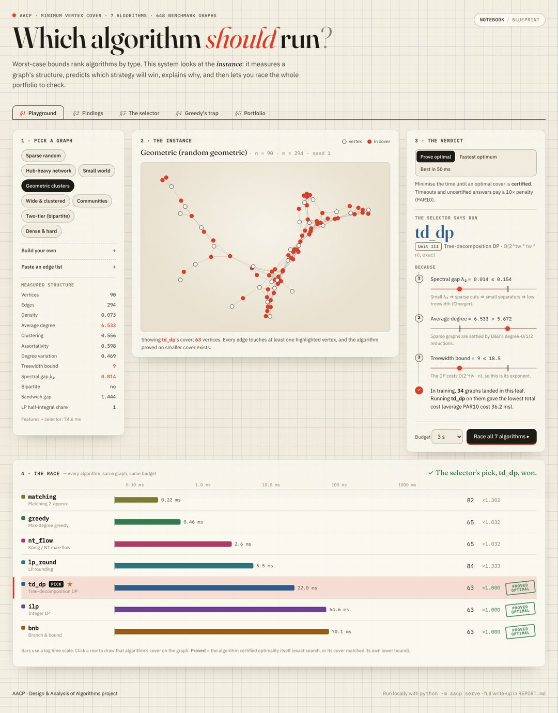
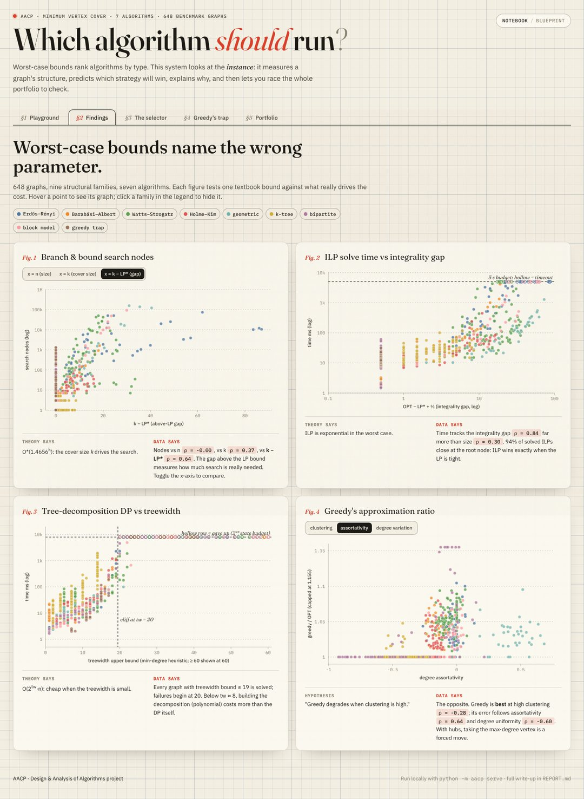
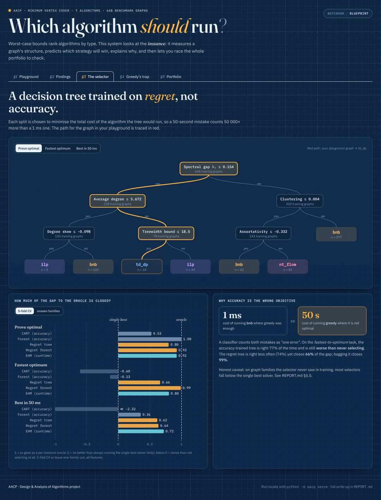
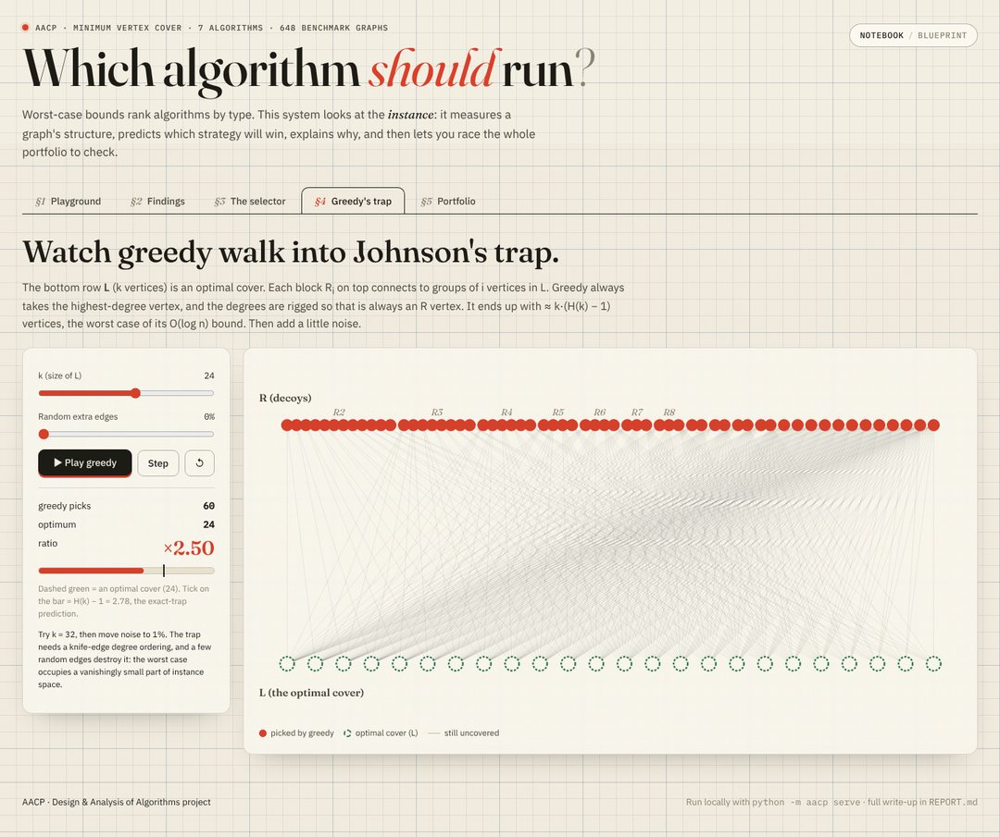

# AACP — Adaptive Algorithm Selection via Learned Complexity Prediction

Given a **problem instance** (not just a problem type), predict which algorithmic
strategy — exact DP, branch & bound, ILP, greedy, LP rounding, or a max-flow
method — will perform best on it, and explain *why* in terms of the
algorithms' theoretical bounds.

The case study is **Minimum Vertex Cover (MVC)**. It is NP-hard, and it can be
attacked with every paradigm in the DAA syllabus:

| algorithm  | paradigm                                    | unit | worst-case guarantee                 |
|------------|---------------------------------------------|------|--------------------------------------|
| `td_dp`    | DP over a tree decomposition                | III  | O(2^tw · tw · n), exact              |
| `bnb`      | backtracking + branch & bound + reductions  | IV   | O*(1.4656^k), exact                  |
| `greedy`   | max-degree greedy                           | IV   | ratio ≤ H(Δ) = O(log n)              |
| `matching` | maximal matching (Gavril)                   | IV   | ratio ≤ 2                            |
| `ilp`      | integer program (HiGHS branch & cut)        | VI   | exponential, exact                   |
| `lp_round` | LP relaxation + half-integral rounding      | VI   | ratio ≤ 2                            |
| `nt_flow`  | Dinic max-flow: König (bipartite) / Nemhauser–Trotter via bipartite double cover | V | exact on bipartite, else ≤ 2 |

Max-flow, the König construction, the tree-decomposition DP, B&B and greedy are
implemented from scratch. Only the ILP/LP solves call a library (SciPy's HiGHS).

📄 **Research write-up: [`REPORT.md`](REPORT.md)** (what we found and why it matters)
📊 Auto-generated numbers: [`reports/results.md`](reports/results.md), figures in [`reports/figures/`](reports/figures)

## Headline results (648 instances, 9 structural families, 5 s budget)

* **Worst-case bounds are poor predictors; structural "gap" parameters are good ones.**
  B&B search-tree size barely depends on *n* (ρ = 0.00) and only weakly on *k*
  (ρ = 0.37), but strongly on the *above-LP gap* k − LP\* (ρ = 0.64). ILP time
  tracks the integrality gap (ρ = 0.84), not *n* (ρ = 0.30). The tree-decomposition
  DP's state count grows as 2^(0.73·w).
* **The suggested hypothesis "greedy fails at high clustering" is refuted by the data.**
  Greedy is *best* at high clustering (mean ratio 1.008 when C > 0.6). It degrades on
  low-clustering, degree-homogeneous, assortative graphs. Its tight H(k) worst case
  (Johnson's trap, ratio 2.95 at k = 40) disappears after adding just 1–3% random edges.
* **When errors are asymmetric, training the selector on accuracy is the wrong
  objective.** In the "time-to-optimum" task, running greedy where it is suboptimal
  costs 50 s while the reverse mistake costs 1 ms. There, an accuracy-trained CART tree
  (77% accuracy) and random forest (86%) are *worse* than always running the single
  best solver. A regret-minimising decision tree (new here; still a single readable
  tree) closes 66% of the gap to the oracle, and a bagged version closes 99%. On the
  certified-optimum task the regret tree closes 80% (accuracy-trained CART: 53%).
* **Selection does not transfer to unseen graph families.** Under
  leave-one-family-out evaluation only the SATzilla-style runtime-regression model
  (EHM) still beats the single best solver.

## Interactive demo

```bash
python -m aacp serve --open
```

This opens <http://localhost:8000>. The demo has no extra dependencies and no build
step, and the fonts are bundled, so it works offline in a classroom. It has five
sections:

| § | section | what it shows |
|---|---|---|
| 1 | **Playground** | Pick a preset (or build or paste a graph). The selector's verdict comes with its decision path, drawn as number lines. Then race all 7 algorithms live, with *proved optimal* stamps, and click any row to draw that algorithm's cover. |
| 2 | **Findings** | Interactive versions of the theory-vs-practice figures, with switchable x-axes and family filters. |
| 3 | **The selector** | The learned regret tree, with your graph's path traced through it, and gap-closed results for every selector. |
| 4 | **Greedy's trap** | A step-by-step animation of greedy falling into Johnson's construction, and how a little noise breaks the trap. |
| 5 | **Portfolio** | The textbook guarantee next to the measured performance for each algorithm. |

There is a *Notebook / Blueprint* theme switch in the top-right corner.

| | |
|---|---|
|  |  |
|  |  |

Demo tips: *Geometric clusters* → `td_dp`, *Wide & clustered* → `ilp`, *Two-tier* →
`nt_flow`, and *Hub-heavy* → `bnb`. In each case, hit **Race** to check the pick.

## Quick start

```bash
pip install -r requirements.txt
```

```bash
python -m pytest -q
```

```bash
python -m aacp benchmark --scale 2 --budget 5
```

```bash
python -m aacp analyze
```

```bash
python -m aacp select --graph my_graph.edgelist --task certified
```

`benchmark` regenerates `data/` (about 13 min on 3 cores; `--scale 0.3` gives a quick
run). `analyze` regenerates `reports/` (about 12 min, mostly cross-validation).
`select` trains the regret-minimising tree on `data/`, prints the decision path that
picked the algorithm, and runs it.

The committed `data/` is the exact run that `REPORT.md` describes. Wall-clock timings
are machine-dependent; the `ops` column gives machine-independent work counts (DP
states, search nodes, MIP nodes, flow phases).

## Layout

```
aacp/
  algorithms/      portfolio (td_dp, bnb, lp [ilp, lp_round], greedy [greedy, matching], flow [Dinic, König, NT])
  graphs.py        instance families with controlled structure (incl. Johnson greedy trap, partial k-trees)
  features.py      structural + probing features (spectral gap, treewidth bound, LP half-integrality, ...)
  benchmark.py     runs the portfolio with cooperative deadlines -> data/{instances,runs}.csv
  selection.py     selection tasks, selectors (CART, RF, cost tree, cost forest, EHM), CV / LOFO evaluation
  costtree.py      regret-minimising decision tree and forest
  analysis.py      theory-vs-practice analysis, figures, reports/results.md
  selector.py      deployable selector with explanations
  web/             demo server (stdlib http.server) + static/ front end (vanilla JS/SVG, vendored fonts)
docs/screenshots/  demo screenshots
tests/             brute-force correctness, LP half-integrality, flow, trap tightness, cost tree
```
