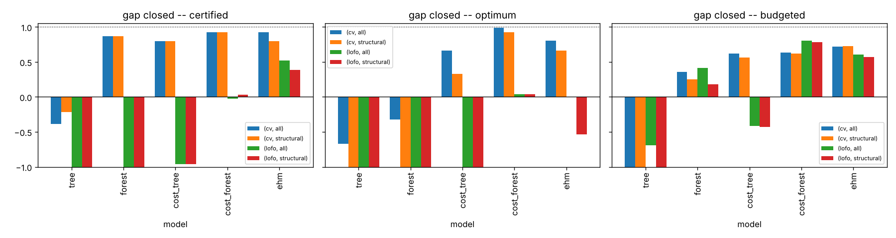
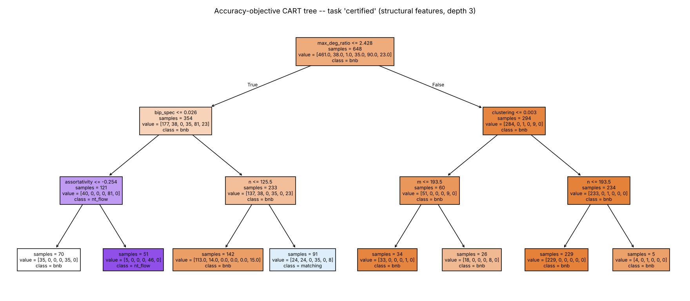
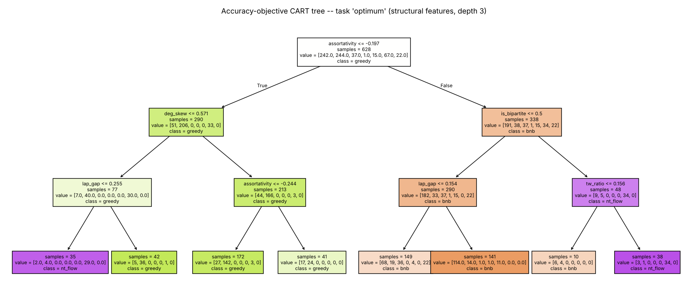
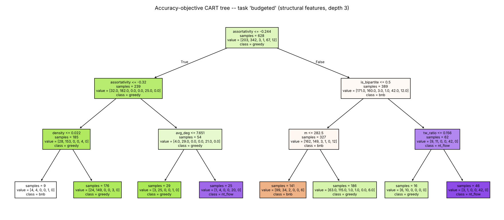
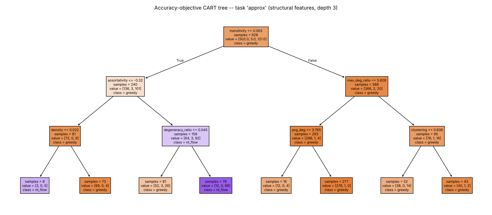

# AACP -- auto-generated results

Instances: 648, budget 5.0 s per run (PAR10 penalty 50 s), 3 parallel workers.

Regenerate with `python -m aacp analyze`. The interpretation lives in `REPORT.md`.

## 1. Portfolio overview

| algorithm   | paradigm                       | unit   | worst-case                          | solved   |   median time [ms] |   mean ratio |   max ratio | % optimal   |
|:------------|:-------------------------------|:-------|:------------------------------------|:---------|-------------------:|-------------:|------------:|:------------|
| td_dp       | exact DP on tree decomposition | III    | O(2^tw * tw * n), exact             | 60.0%    |              22.23 |       1      |      1      | 100.0%      |
| bnb         | backtracking branch & bound    | IV     | O*(1.4656^k), exact                 | 89.5%    |               1.11 |       1      |      1      | 100.0%      |
| ilp         | integer LP (HiGHS B&C)         | VI     | exponential worst case, exact       | 92.4%    |              21.4  |       1      |      1      | 100.0%      |
| greedy      | max-degree greedy              | IV     | ratio <= H(Delta) = O(log n)        | 100.0%   |               0.41 |       1.0867 |      2.95   | 41.9%       |
| matching    | maximal matching (Gavril)      | IV     | ratio <= 2                          | 100.0%   |               0.2  |       1.6211 |      2      | 0.0%        |
| lp_round    | LP relaxation + rounding       | VI     | ratio <= 2                          | 100.0%   |               4.59 |       1.253  |      1.95   | 36.0%       |
| nt_flow     | König / Nemhauser-Trotter flow | V      | exact if bipartite, else ratio <= 2 | 100.0%   |               2.07 |       1.0174 |      1.1045 | 60.4%       |

### Median time [s] by family (solved runs)

| family    |    bnb |   greedy |    ilp |   lp_round |   matching |   nt_flow |   td_dp |
|:----------|-------:|---------:|-------:|-----------:|-----------:|----------:|--------:|
| er        | 0.0253 |   0.0005 | 0.2225 |     0.0058 |     0.0003 |    0.0040 |  0.0159 |
| ba        | 0.0011 |   0.0004 | 0.0125 |     0.0044 |     0.0002 |    0.0027 |  0.0133 |
| ws        | 0.0111 |   0.0003 | 0.0904 |     0.0043 |     0.0002 |    0.0027 |  0.0286 |
| plc       | 0.0009 |   0.0004 | 0.0205 |     0.0045 |     0.0002 |    0.0027 |  0.0234 |
| rgg       | 0.0026 |   0.0005 | 0.0597 |     0.0052 |     0.0002 |    0.0028 |  0.0121 |
| ktree     | 0.0008 |   0.0005 | 0.0237 |     0.0053 |     0.0003 |    0.0030 |  0.0350 |
| bipartite | 0.0007 |   0.0003 | 0.0100 |     0.0039 |     0.0002 |    0.0007 |  0.0086 |
| sbm       | 0.0085 |   0.0005 | 0.0797 |     0.0052 |     0.0003 |    0.0028 |  0.0149 |
| trap      | 0.0007 |   0.0004 | 0.0101 |     0.0039 |     0.0002 |    0.0005 |  0.0058 |

### Fraction solved within budget

| family    |   bnb |   greedy |   ilp |   lp_round |   matching |   nt_flow |   td_dp |
|:----------|------:|---------:|------:|-----------:|-----------:|----------:|--------:|
| er        |  0.78 |     1.00 |  0.61 |       1.00 |       1.00 |      1.00 |    0.17 |
| ba        |  1.00 |     1.00 |  1.00 |       1.00 |       1.00 |      1.00 |    0.56 |
| ws        |  0.75 |     1.00 |  0.93 |       1.00 |       1.00 |      1.00 |    0.65 |
| plc       |  1.00 |     1.00 |  1.00 |       1.00 |       1.00 |      1.00 |    0.69 |
| rgg       |  0.64 |     1.00 |  1.00 |       1.00 |       1.00 |      1.00 |    0.61 |
| ktree     |  1.00 |     1.00 |  1.00 |       1.00 |       1.00 |      1.00 |    1.00 |
| bipartite |  1.00 |     1.00 |  1.00 |       1.00 |       1.00 |      1.00 |    0.44 |
| sbm       |  0.58 |     1.00 |  0.61 |       1.00 |       1.00 |      1.00 |    0.44 |
| trap      |  1.00 |     1.00 |  1.00 |       1.00 |       1.00 |      1.00 |    0.50 |

### Mean approximation ratio

| family    |   bnb |   greedy |   ilp |   lp_round |   matching |   nt_flow |   td_dp |
|:----------|------:|---------:|------:|-----------:|-----------:|----------:|--------:|
| er        | 1.000 |    1.038 | 1.000 |      1.352 |      1.354 |     1.036 |   1.000 |
| ba        | 1.000 |    1.022 | 1.000 |      1.269 |      1.665 |     1.016 |   1.000 |
| ws        | 1.000 |    1.054 | 1.000 |      1.549 |      1.384 |     1.054 |   1.000 |
| plc       | 1.000 |    1.018 | 1.000 |      1.397 |      1.592 |     1.013 |   1.000 |
| rgg       | 1.000 |    1.030 | 1.000 |      1.274 |      1.250 |     1.028 |   1.000 |
| ktree     | 1.000 |    1.002 | 1.000 |      1.195 |      1.636 |     1.000 |   1.000 |
| bipartite | 1.000 |    1.042 | 1.000 |      1.000 |      1.920 |     1.000 |   1.000 |
| sbm       | 1.000 |    1.034 | 1.000 |      1.365 |      1.358 |     1.034 |   1.000 |
| trap      | 1.000 |    1.409 | 1.000 |      1.000 |      1.997 |     1.000 |   1.000 |

## 2. Theory vs practice

### td_dp

```json
{
  "solved_frac": 0.6003086419753086,
  "states_slope_per_width": 0.7269527469403244,
  "states_slope_r2": 0.8877589878729247,
  "time_slope_per_width": 0.3232910611993368,
  "time_slope_r2": 0.48902422403876866,
  "time_slope_per_width_w>=8": 0.5454118551090232,
  "max_width_solved": 21,
  "max_tw_ub_solved": 23,
  "min_tw_ub_failed": 20,
  "median_tw_ub_failed": 37.0,
  "spearman_time_vs_width": 0.6326456227294665,
  "spearman_time_vs_n": 0.577400185021638,
  "spearman_time_vs_m": 0.8352119939848793,
  "tw_feature_vs_width_spearman": 0.9866157067500523
}
```

### bnb

```json
{
  "solved_frac": 0.8950617283950617,
  "theory_base": 1.4656,
  "empirical_base_per_k": 1.0512079663005474,
  "r2_k": 0.21234274680934975,
  "spearman_nodes_vs_k": 0.37090411200282425,
  "spearman_nodes_vs_n": -0.003917701627981743,
  "spearman_nodes_vs_above_lp": 0.6409116414838175,
  "spearman_nodes_vs_density": 0.12240183116051002,
  "empirical_base_per_above_lp_unit": 1.0845248260305806,
  "frac_solved_at_root": 0.4689655172413793
}
```

### ilp

```json
{
  "solved_frac": 0.9243827160493827,
  "spearman_time_vs_int_gap": 0.8446563545074235,
  "spearman_time_vs_n": 0.30445521064367265,
  "spearman_time_vs_density": 0.062392079692441496,
  "frac_root_solved": 0.9398998330550918,
  "mean_int_gap_solved": 6.607679465776294,
  "mean_int_gap_timeout": 41.94827586206897
}
```

### greedy

```json
{
  "mean_ratio": 1.0867314161122812,
  "max_ratio": 2.95,
  "frac_optimal": 0.41878980891719747,
  "bound_ever_violated": false,
  "max_ratio_over_bound": 0.6894870457428787,
  "spearman_ratio_vs_feature_nontrap": {
    "clustering": -0.28304757456763263,
    "transitivity": 0.04045335962774442,
    "deg_cv": -0.6005771386118445,
    "density": -0.1373541296596127,
    "avg_deg": -0.08216263652613413,
    "tw_ratio": 0.35966691827332337,
    "assortativity": 0.6363501237269003,
    "is_bipartite": -0.10530921653468281,
    "lap_gap": -0.17377264567892933,
    "frac_leaves": -0.09243032727011148,
    "degeneracy_ratio": -0.0626722689341637
  },
  "by_clustering": [
    {
      "clustering": "(-0.01, 0.05]",
      "mean": "1.0409",
      "max": "1.4348",
      "count": "119",
      "p_subopt": "0.563"
    },
    {
      "clustering": "(0.05, 0.2]",
      "mean": "1.0363",
      "max": "1.1045",
      "count": "90",
      "p_subopt": "0.8556"
    },
    {
      "clustering": "(0.2, 0.4]",
      "mean": "1.0323",
      "max": "1.0952",
      "count": "83",
      "p_subopt": "0.7711"
    },
    {
      "clustering": "(0.4, 0.6]",
      "mean": "1.029",
      "max": "1.0952",
      "count": "119",
      "p_subopt": "0.6723"
    },
    {
      "clustering": "(0.6, 1.0]",
      "mean": "1.0078",
      "max": "1.0588",
      "count": "121",
      "p_subopt": "0.2727"
    }
  ],
  "trap_ratio_by_k_noise": {
    "0.0": {
      "8": 1.5,
      "12": 1.917,
      "16": 2.125,
      "24": 2.5,
      "32": 2.719,
      "40": 2.95
    },
    "0.01": {
      "8": 1.406,
      "12": 1.646,
      "16": 1.469,
      "24": 1.021,
      "32": 1.0,
      "40": 1.0
    },
    "0.03": {
      "8": 1.281,
      "12": 1.062,
      "16": 1.0,
      "24": 1.0,
      "32": 1.0,
      "40": 1.0
    },
    "0.08": {
      "8": 1.219,
      "12": 1.0,
      "16": 1.0,
      "24": 1.0,
      "32": 1.0,
      "40": 1.0
    }
  },
  "trap_H_k_minus_1": {
    "8": 1.718,
    "12": 2.103,
    "16": 2.381,
    "24": 2.776,
    "32": 3.058,
    "40": 3.279
  }
}
```

Depth-2 regression tree on greedy ratio (non-trap instances):

```
|--- assortativity <= -0.175
|   |--- assortativity <= -0.244
|   |   |--- value: [1.002]
|   |--- assortativity >  -0.244
|   |   |--- value: [1.019]
|--- assortativity >  -0.175
|   |--- clustering <= 0.022
|   |   |--- value: [1.079]
|   |--- clustering >  0.022
|   |   |--- value: [1.039]

```

### matching

```json
{
  "mean_ratio": 1.6210753309261843,
  "max_ratio": 2.0,
  "spearman_ratio_vs_density": -0.02006351365186738,
  "spearman_ratio_vs_avg_deg": -0.11639928207169964,
  "mean_ratio_density_gt_0.3": 1.2382158684367854,
  "mean_ratio_density_lt_0.05": 1.6199382672373919
}
```

### lp_round

```json
{
  "mean_ratio": 1.252968376927872,
  "max_ratio": 1.95,
  "spearman_ratio_vs_half_frac": 0.8337849016252589,
  "frac_certified": 0.35987261146496813,
  "mean_ratio_bipartite": 1.0
}
```

### nt_flow

```json
{
  "mean_ratio": 1.0174426184361391,
  "max_ratio": 1.1044776119402986,
  "frac_certified": 0.4140127388535032,
  "mean_ratio_nonbipartite": 1.024505513149654,
  "frac_better_than_greedy": 0.18789808917197454,
  "frac_worse_than_greedy": 0.0
}
```

Figures: `figures/A_td_dp_width.png`, `figures/B_bnb_nodes.png`, `figures/C_ilp_gap.png`, `figures/D_greedy.png`, `figures/E_two_approx.png`

## 3. Algorithm selection



Gap closed = (SBS - AS) / (SBS - VBS); 1 = oracle, 0 = no better than always running the single best solver. Costs are mean PAR10 seconds (certified / optimum) or mean approximation ratio (approx).

| task      | model       | features   | protocol   |   n |   accuracy |     AS |   AS_feat |    SBS |    VBS |   solved_AS |   solved_SBS |   gap_closed |
|:----------|:------------|:-----------|:-----------|----:|-----------:|-------:|----------:|-------:|-------:|------------:|-------------:|-------------:|
| certified | tree        | structural | cv         | 648 |     0.8256 | 4.1860 |    4.2095 | 3.9342 | 2.7760 |      0.9182 |       0.9244 |      -0.2174 |
| certified | forest      | structural | cv         | 648 |     0.9090 | 2.9300 |    2.9535 | 3.9342 | 2.7760 |      0.9429 |       0.9244 |       0.8670 |
| certified | cost_tree   | structural | cv         | 648 |     0.8164 | 3.0106 |    3.0341 | 3.9342 | 2.7760 |      0.9414 |       0.9244 |       0.7974 |
| certified | cost_forest | structural | cv         | 648 |     0.6914 | 2.8623 |    2.8858 | 3.9342 | 2.7760 |      0.9444 |       0.9244 |       0.9255 |
| certified | ehm         | structural | cv         | 648 |     0.8688 | 3.0107 |    3.0342 | 3.9342 | 2.7760 |      0.9414 |       0.9244 |       0.7973 |
| certified | tree        | all        | cv         | 648 |     0.8117 | 4.3827 |    4.4113 | 3.9342 | 2.7760 |      0.9136 |       0.9244 |      -0.3873 |
| certified | forest      | all        | cv         | 648 |     0.9120 | 2.9248 |    2.9534 | 3.9342 | 2.7760 |      0.9429 |       0.9244 |       0.8715 |
| certified | cost_tree   | all        | cv         | 648 |     0.8333 | 3.0105 |    3.0391 | 3.9342 | 2.7760 |      0.9414 |       0.9244 |       0.7975 |
| certified | cost_forest | all        | cv         | 648 |     0.6883 | 2.8618 |    2.8904 | 3.9342 | 2.7760 |      0.9444 |       0.9244 |       0.9259 |
| certified | ehm         | all        | cv         | 648 |     0.8565 | 2.8640 |    2.8926 | 3.9342 | 2.7760 |      0.9444 |       0.9244 |       0.9240 |
| certified | tree        | structural | lofo       | 648 |     0.7114 | 7.6425 |    7.6660 | 3.9342 | 2.7760 |      0.8488 |       0.9244 |      -3.2019 |
| certified | forest      | structural | lofo       | 648 |     0.7423 | 6.3872 |    6.4107 | 3.9342 | 2.7760 |      0.8735 |       0.9244 |      -2.1180 |
| certified | cost_tree   | structural | lofo       | 648 |     0.6883 | 5.0498 |    5.0733 | 3.9342 | 2.7760 |      0.9012 |       0.9244 |      -0.9633 |
| certified | cost_forest | structural | lofo       | 648 |     0.5309 | 3.8972 |    3.9207 | 3.9342 | 2.7760 |      0.9244 |       0.9244 |       0.0319 |
| certified | ehm         | structural | lofo       | 648 |     0.7654 | 3.4906 |    3.5141 | 3.9342 | 2.7760 |      0.9321 |       0.9244 |       0.3830 |
| certified | tree        | all        | lofo       | 648 |     0.6991 | 7.6375 |    7.6661 | 3.9342 | 2.7760 |      0.8488 |       0.9244 |      -3.1975 |
| certified | forest      | all        | lofo       | 648 |     0.7222 | 6.2336 |    6.2622 | 3.9342 | 2.7760 |      0.8765 |       0.9244 |      -1.9854 |
| certified | cost_tree   | all        | lofo       | 648 |     0.7130 | 5.0485 |    5.0771 | 3.9342 | 2.7760 |      0.9012 |       0.9244 |      -0.9622 |
| certified | cost_forest | all        | lofo       | 648 |     0.5988 | 3.9656 |    3.9942 | 3.9342 | 2.7760 |      0.9228 |       0.9244 |      -0.0271 |
| certified | ehm         | all        | lofo       | 648 |     0.7670 | 3.3303 |    3.3589 | 3.9342 | 2.7760 |      0.9352 |       0.9244 |       0.5214 |
| optimum   | tree        | structural | cv         | 628 |     0.6815 | 4.6927 |    4.7149 | 2.4671 | 1.2715 |      0.9076 |       0.9538 |      -1.8616 |
| optimum   | forest      | structural | cv         | 628 |     0.8073 | 3.8094 |    3.8315 | 2.4671 | 1.2715 |      0.9252 |       0.9538 |      -1.1227 |
| optimum   | cost_tree   | structural | cv         | 628 |     0.6513 | 2.0731 |    2.0952 | 2.4671 | 1.2715 |      0.9602 |       0.9538 |       0.3296 |
| optimum   | cost_forest | structural | cv         | 628 |     0.3997 | 1.3612 |    1.3833 | 2.4671 | 1.2715 |      0.9745 |       0.9538 |       0.9250 |
| optimum   | ehm         | structural | cv         | 628 |     0.6385 | 1.6740 |    1.6961 | 2.4671 | 1.2715 |      0.9682 |       0.9538 |       0.6634 |
| optimum   | tree        | all        | cv         | 628 |     0.7436 | 3.2726 |    3.2994 | 2.4671 | 1.2715 |      0.9363 |       0.9538 |      -0.6737 |
| optimum   | forest      | all        | cv         | 628 |     0.8599 | 2.8539 |    2.8807 | 2.4671 | 1.2715 |      0.9443 |       0.9538 |      -0.3236 |
| optimum   | cost_tree   | all        | cv         | 628 |     0.7261 | 1.6748 |    1.7016 | 2.4671 | 1.2715 |      0.9682 |       0.9538 |       0.6627 |
| optimum   | cost_forest | all        | cv         | 628 |     0.4140 | 1.2846 |    1.3114 | 2.4671 | 1.2715 |      0.9761 |       0.9538 |       0.9890 |
| optimum   | ehm         | all        | cv         | 628 |     0.7484 | 1.5090 |    1.5358 | 2.4671 | 1.2715 |      0.9713 |       0.9538 |       0.8014 |
| optimum   | tree        | structural | lofo       | 628 |     0.5478 | 8.5985 |    8.6206 | 2.4671 | 1.2715 |      0.8296 |       0.9538 |      -5.1283 |
| optimum   | forest      | structural | lofo       | 628 |     0.6385 | 9.9348 |    9.9569 | 2.4671 | 1.2715 |      0.8025 |       0.9538 |      -6.2460 |
| optimum   | cost_tree   | structural | lofo       | 628 |     0.5032 | 5.8396 |    5.8617 | 2.4671 | 1.2715 |      0.8854 |       0.9538 |      -2.8208 |
| optimum   | cost_forest | structural | lofo       | 628 |     0.2962 | 2.4228 |    2.4449 | 2.4671 | 1.2715 |      0.9538 |       0.9538 |       0.0371 |
| optimum   | ehm         | structural | lofo       | 628 |     0.4825 | 3.1064 |    3.1285 | 2.4671 | 1.2715 |      0.9395 |       0.9538 |      -0.5347 |
| optimum   | tree        | all        | lofo       | 628 |     0.5239 | 5.1291 |    5.1558 | 2.4671 | 1.2715 |      0.8997 |       0.9538 |      -2.2265 |
| optimum   | forest      | all        | lofo       | 628 |     0.6704 | 5.8984 |    5.9252 | 2.4671 | 1.2715 |      0.8838 |       0.9538 |      -2.8699 |
| optimum   | cost_tree   | all        | lofo       | 628 |     0.5796 | 5.6799 |    5.7067 | 2.4671 | 1.2715 |      0.8885 |       0.9538 |      -2.6872 |
| optimum   | cost_forest | all        | lofo       | 628 |     0.3073 | 2.4232 |    2.4499 | 2.4671 | 1.2715 |      0.9538 |       0.9538 |       0.0367 |
| optimum   | ehm         | all        | lofo       | 628 |     0.6083 | 2.4659 |    2.4927 | 2.4671 | 1.2715 |      0.9522 |       0.9538 |       0.0010 |
| budgeted  | tree        | structural | cv         | 628 |     0.7150 | 1.0974 |  nan      | 1.0333 | 1.0067 |    nan      |     nan      |      -2.4101 |
| budgeted  | forest      | structural | cv         | 628 |     0.7930 | 1.0266 |  nan      | 1.0333 | 1.0067 |    nan      |     nan      |       0.2545 |
| budgeted  | cost_tree   | structural | cv         | 628 |     0.4252 | 1.0184 |  nan      | 1.0333 | 1.0067 |    nan      |     nan      |       0.5614 |
| budgeted  | cost_forest | structural | cv         | 628 |     0.3726 | 1.0167 |  nan      | 1.0333 | 1.0067 |    nan      |     nan      |       0.6233 |
| budgeted  | ehm         | structural | cv         | 628 |     0.3471 | 1.0139 |  nan      | 1.0333 | 1.0067 |    nan      |     nan      |       0.7292 |
| budgeted  | tree        | all        | cv         | 628 |     0.7277 | 1.0950 |  nan      | 1.0333 | 1.0067 |    nan      |     nan      |      -2.3212 |
| budgeted  | forest      | all        | cv         | 628 |     0.8535 | 1.0239 |  nan      | 1.0333 | 1.0067 |    nan      |     nan      |       0.3555 |
| budgeted  | cost_tree   | all        | cv         | 628 |     0.4968 | 1.0169 |  nan      | 1.0333 | 1.0067 |    nan      |     nan      |       0.6175 |
| budgeted  | cost_forest | all        | cv         | 628 |     0.3997 | 1.0164 |  nan      | 1.0333 | 1.0067 |    nan      |     nan      |       0.6357 |
| budgeted  | ehm         | all        | cv         | 628 |     0.4363 | 1.0142 |  nan      | 1.0333 | 1.0067 |    nan      |     nan      |       0.7208 |
| budgeted  | tree        | structural | lofo       | 628 |     0.5780 | 1.2344 |  nan      | 1.0958 | 1.0067 |    nan      |     nan      |      -1.5556 |
| budgeted  | forest      | structural | lofo       | 628 |     0.6704 | 1.0797 |  nan      | 1.0958 | 1.0067 |    nan      |     nan      |       0.1805 |
| budgeted  | cost_tree   | structural | lofo       | 628 |     0.3010 | 1.1341 |  nan      | 1.0958 | 1.0067 |    nan      |     nan      |      -0.4300 |
| budgeted  | cost_forest | structural | lofo       | 628 |     0.2564 | 1.0262 |  nan      | 1.0958 | 1.0067 |    nan      |     nan      |       0.7816 |
| budgeted  | ehm         | structural | lofo       | 628 |     0.2898 | 1.0451 |  nan      | 1.0958 | 1.0067 |    nan      |     nan      |       0.5692 |
| budgeted  | tree        | all        | lofo       | 628 |     0.5701 | 1.1573 |  nan      | 1.0958 | 1.0067 |    nan      |     nan      |      -0.6895 |
| budgeted  | forest      | all        | lofo       | 628 |     0.7118 | 1.0591 |  nan      | 1.0958 | 1.0067 |    nan      |     nan      |       0.4124 |
| budgeted  | cost_tree   | all        | lofo       | 628 |     0.4076 | 1.1331 |  nan      | 1.0958 | 1.0067 |    nan      |     nan      |      -0.4177 |
| budgeted  | cost_forest | all        | lofo       | 628 |     0.2484 | 1.0238 |  nan      | 1.0958 | 1.0067 |    nan      |     nan      |       0.8079 |
| budgeted  | ehm         | all        | lofo       | 628 |     0.2978 | 1.0421 |  nan      | 1.0958 | 1.0067 |    nan      |     nan      |       0.6026 |
| approx    | tree        | structural | cv         | 628 |     0.8646 | 1.0199 |  nan      | 1.0174 | 1.0173 |    nan      |     nan      |     -16.7748 |
| approx    | forest      | structural | cv         | 628 |     0.9108 | 1.0200 |  nan      | 1.0174 | 1.0173 |    nan      |     nan      |     -17.0549 |
| approx    | cost_tree   | structural | cv         | 628 |     0.4936 | 1.0178 |  nan      | 1.0174 | 1.0173 |    nan      |     nan      |      -2.5337 |
| approx    | cost_forest | structural | cv         | 628 |     0.3010 | 1.0175 |  nan      | 1.0174 | 1.0173 |    nan      |     nan      |      -0.5075 |
| approx    | ehm         | structural | cv         | 628 |     0.3248 | 1.0176 |  nan      | 1.0174 | 1.0173 |    nan      |     nan      |      -0.9785 |
| approx    | tree        | all        | cv         | 628 |     0.9045 | 1.0190 |  nan      | 1.0174 | 1.0173 |    nan      |     nan      |     -10.5226 |
| approx    | forest      | all        | cv         | 628 |     0.9411 | 1.0186 |  nan      | 1.0174 | 1.0173 |    nan      |     nan      |      -7.5905 |
| approx    | cost_tree   | all        | cv         | 628 |     0.5525 | 1.0178 |  nan      | 1.0174 | 1.0173 |    nan      |     nan      |      -2.1160 |
| approx    | cost_forest | all        | cv         | 628 |     0.2882 | 1.0175 |  nan      | 1.0174 | 1.0173 |    nan      |     nan      |      -0.5075 |
| approx    | ehm         | all        | cv         | 628 |     0.5143 | 1.0174 |  nan      | 1.0174 | 1.0173 |    nan      |     nan      |       0.0049 |
| approx    | tree        | structural | lofo       | 628 |     0.7484 | 1.0314 |  nan      | 1.0174 | 1.0173 |    nan      |     nan      |     -93.4484 |
| approx    | forest      | structural | lofo       | 628 |     0.8201 | 1.0774 |  nan      | 1.0174 | 1.0173 |    nan      |     nan      |    -401.1723 |
| approx    | cost_tree   | structural | lofo       | 628 |     0.4411 | 1.0216 |  nan      | 1.0174 | 1.0173 |    nan      |     nan      |     -27.8568 |
| approx    | cost_forest | structural | lofo       | 628 |     0.2229 | 1.0191 |  nan      | 1.0174 | 1.0173 |    nan      |     nan      |     -11.4064 |
| approx    | ehm         | structural | lofo       | 628 |     0.2994 | 1.0178 |  nan      | 1.0174 | 1.0173 |    nan      |     nan      |      -2.4005 |
| approx    | tree        | all        | lofo       | 628 |     0.8169 | 1.0632 |  nan      | 1.0174 | 1.0173 |    nan      |     nan      |    -306.1079 |
| approx    | forest      | all        | lofo       | 628 |     0.9061 | 1.0211 |  nan      | 1.0174 | 1.0173 |    nan      |     nan      |     -24.1819 |
| approx    | cost_tree   | all        | lofo       | 628 |     0.4379 | 1.0787 |  nan      | 1.0174 | 1.0173 |    nan      |     nan      |    -410.0399 |
| approx    | cost_forest | all        | lofo       | 628 |     0.2452 | 1.0185 |  nan      | 1.0174 | 1.0173 |    nan      |     nan      |      -7.2598 |
| approx    | ehm         | all        | lofo       | 628 |     0.3392 | 1.0177 |  nan      | 1.0174 | 1.0173 |    nan      |     nan      |      -1.7780 |

### Task `certified`

Label distribution: `{'bnb': 461, 'nt_flow': 90, 'ilp': 38, 'matching': 35, 'td_dp': 23, 'lp_round': 1}`

Oracle label by family:

| family    |   bnb |   ilp |   lp_round |   matching |   nt_flow |   td_dp |
|:----------|------:|------:|-----------:|-----------:|----------:|--------:|
| er        |    56 |     0 |          0 |         16 |         0 |       0 |
| ba        |    46 |     0 |          1 |          0 |         1 |       0 |
| ws        |    56 |    21 |          0 |          6 |         0 |      13 |
| plc       |    72 |     0 |          0 |          0 |         0 |       0 |
| rgg       |    15 |    14 |          0 |          0 |         0 |       7 |
| ktree     |   120 |     0 |          0 |          0 |         0 |       0 |
| bipartite |    33 |     0 |          0 |          0 |        39 |       0 |
| sbm       |    17 |     3 |          0 |         13 |         0 |       3 |
| trap      |    46 |     0 |          0 |          0 |        50 |       0 |

Regret-minimising tree (depth 3, structural features; leaf cost in task units):

```
|--- lap_gap <= 0.154
|   |--- avg_deg <= 5.67
|   |   |--- deg_skew <= -0.098
|   |   |   |--- run ilp  (n=5, mean cost 0.029)
|   |   |--- deg_skew >  -0.098
|   |   |   |--- run bnb  (n=145, mean cost 0.0152)
|   |--- avg_deg >  5.67
|   |   |--- tw_ub <= 18.5
|   |   |   |--- run td_dp  (n=34, mean cost 0.0362)
|   |   |--- tw_ub >  18.5
|   |   |   |--- run ilp  (n=44, mean cost 6.1)
|--- lap_gap >  0.154
|   |--- clustering <= 0.0044
|   |   |--- assortativity <= -0.332
|   |   |   |--- run bnb  (n=60, mean cost 0.000973)
|   |   |--- assortativity >  -0.332
|   |   |   |--- run nt_flow  (n=83, mean cost 0.000777)
|   |--- clustering >  0.0044
|   |   |--- run bnb  (n=277, mean cost 5.52)
```

Cost-tree feature usage (share of total regret reduction): `{'lap_gap': np.float64(0.991), 'avg_deg': np.float64(0.005), 'tw_ub': np.float64(0.003), 'clustering': np.float64(0.001), 'deg_skew': np.float64(0.001), 'assortativity': np.float64(0.0)}`

Accuracy-objective CART tree (train acc 0.792):

```
|--- max_deg_ratio <= 2.428
|   |--- bip_spec <= 0.026
|   |   |--- assortativity <= -0.254
|   |   |   |--- class: bnb
|   |   |--- assortativity >  -0.254
|   |   |   |--- class: nt_flow
|   |--- bip_spec >  0.026
|   |   |--- n <= 125.500
|   |   |   |--- class: bnb
|   |   |--- n >  125.500
|   |   |   |--- class: matching
|--- max_deg_ratio >  2.428
|   |--- clustering <= 0.003
|   |   |--- m <= 193.500
|   |   |   |--- class: bnb
|   |   |--- m >  193.500
|   |   |   |--- class: bnb
|   |--- clustering >  0.003
|   |   |--- n <= 193.500
|   |   |   |--- class: bnb
|   |   |--- n >  193.500
|   |   |   |--- class: bnb

```

Top permutation importances (forest, all features):

|                  |   gini |   perm_mean |   perm_std |
|:-----------------|-------:|------------:|-----------:|
| sandwich_gap     | 0.0860 |      0.0167 |     0.0089 |
| n                | 0.0575 |      0.0141 |     0.0076 |
| tw_ub            | 0.0779 |      0.0126 |     0.0055 |
| adj_lambda_ratio | 0.0349 |      0.0126 |     0.0030 |
| deg_cv           | 0.0432 |      0.0097 |     0.0060 |
| density          | 0.0349 |      0.0087 |     0.0040 |
| degeneracy_ratio | 0.0262 |      0.0038 |     0.0039 |
| lp_ratio         | 0.0126 |      0.0036 |     0.0029 |
| m                | 0.0445 |      0.0026 |     0.0057 |
| max_deg_ratio    | 0.0731 |      0.0026 |     0.0080 |



### Task `optimum`

Label distribution: `{'greedy': 244, 'bnb': 242, 'nt_flow': 67, 'ilp': 37, 'td_dp': 22, 'matching': 15, 'lp_round': 1}`

Oracle label by family:

| family    |   bnb |   greedy |   ilp |   lp_round |   matching |   nt_flow |   td_dp |
|:----------|------:|---------:|------:|-----------:|-----------:|----------:|--------:|
| er        |    51 |        5 |     0 |          0 |          2 |         0 |       0 |
| ba        |    27 |       20 |     0 |          1 |          0 |         0 |       0 |
| ws        |    54 |        2 |    21 |          0 |          6 |         0 |      13 |
| plc       |    45 |       27 |     0 |          0 |          0 |         0 |       0 |
| rgg       |    12 |        5 |    13 |          0 |          0 |         0 |       6 |
| ktree     |    21 |       99 |     0 |          0 |          0 |         0 |       0 |
| bipartite |    12 |       32 |     0 |          0 |          0 |        28 |       0 |
| sbm       |    12 |        5 |     3 |          0 |          7 |         0 |       3 |
| trap      |     8 |       49 |     0 |          0 |          0 |        39 |       0 |

Regret-minimising tree (depth 3, structural features; leaf cost in task units):

```
|--- lap_gap <= 0.154
|   |--- avg_deg <= 5.67
|   |   |--- deg_skew <= -0.098
|   |   |   |--- run ilp  (n=5, mean cost 0.029)
|   |   |--- deg_skew >  -0.098
|   |   |   |--- run bnb  (n=145, mean cost 0.0152)
|   |--- avg_deg >  5.67
|   |   |--- tw_ub <= 18.5
|   |   |   |--- run td_dp  (n=34, mean cost 0.0362)
|   |   |--- tw_ub >  18.5
|   |   |   |--- run ilp  (n=43, mean cost 5.08)
|--- lap_gap >  0.154
|   |--- is_bipartite <= 0.5
|   |   |--- assortativity <= -0.55
|   |   |   |--- run greedy  (n=26, mean cost 0.00135)
|   |   |--- assortativity >  -0.55
|   |   |   |--- run bnb  (n=232, mean cost 2.5)
|   |--- is_bipartite >  0.5
|   |   |--- assortativity <= -0.335
|   |   |   |--- run greedy  (n=59, mean cost 0.000739)
|   |   |--- assortativity >  -0.335
|   |   |   |--- run nt_flow  (n=84, mean cost 0.00077)
```

Cost-tree feature usage (share of total regret reduction): `{'lap_gap': np.float64(0.991), 'avg_deg': np.float64(0.005), 'tw_ub': np.float64(0.003), 'is_bipartite': np.float64(0.001), 'deg_skew': np.float64(0.001), 'assortativity': np.float64(0.0)}`

Accuracy-objective CART tree (train acc 0.721):

```
|--- assortativity <= -0.197
|   |--- deg_skew <= 0.571
|   |   |--- lap_gap <= 0.255
|   |   |   |--- class: nt_flow
|   |   |--- lap_gap >  0.255
|   |   |   |--- class: greedy
|   |--- deg_skew >  0.571
|   |   |--- assortativity <= -0.244
|   |   |   |--- class: greedy
|   |   |--- assortativity >  -0.244
|   |   |   |--- class: greedy
|--- assortativity >  -0.197
|   |--- is_bipartite <= 0.500
|   |   |--- lap_gap <= 0.154
|   |   |   |--- class: bnb
|   |   |--- lap_gap >  0.154
|   |   |   |--- class: bnb
|   |--- is_bipartite >  0.500
|   |   |--- tw_ratio <= 0.156
|   |   |   |--- class: bnb
|   |   |--- tw_ratio >  0.156
|   |   |   |--- class: nt_flow

```

Top permutation importances (forest, all features):

|                  |   gini |   perm_mean |   perm_std |
|:-----------------|-------:|------------:|-----------:|
| sandwich_gap     | 0.1538 |      0.1328 |     0.0232 |
| deg_cv           | 0.0566 |      0.0167 |     0.0070 |
| clustering       | 0.0591 |      0.0153 |     0.0095 |
| tw_ub            | 0.0444 |      0.0122 |     0.0082 |
| max_deg_ratio    | 0.0428 |      0.0119 |     0.0058 |
| degeneracy_ratio | 0.0268 |      0.0108 |     0.0054 |
| n                | 0.0343 |      0.0087 |     0.0054 |
| is_bipartite     | 0.0181 |      0.0074 |     0.0039 |
| lp_half_frac     | 0.0471 |      0.0071 |     0.0061 |
| tw_ratio         | 0.0371 |      0.0061 |     0.0048 |



### Task `budgeted`

Label distribution: `{'greedy': 342, 'bnb': 203, 'nt_flow': 67, 'td_dp': 12, 'ilp': 3, 'lp_round': 1}`

Oracle label by family:

| family    |   bnb |   greedy |   ilp |   lp_round |   nt_flow |   td_dp |
|:----------|------:|---------:|------:|-----------:|----------:|--------:|
| er        |    28 |       30 |     0 |          0 |         0 |       0 |
| ba        |    24 |       23 |     0 |          1 |         0 |       0 |
| ws        |    45 |       41 |     3 |          0 |         0 |       7 |
| plc       |    45 |       27 |     0 |          0 |         0 |       0 |
| rgg       |    12 |       20 |     0 |          0 |         0 |       4 |
| ktree     |    21 |       99 |     0 |          0 |         0 |       0 |
| bipartite |    12 |       32 |     0 |          0 |        28 |       0 |
| sbm       |     8 |       21 |     0 |          0 |         0 |       1 |
| trap      |     8 |       49 |     0 |          0 |        39 |       0 |

Regret-minimising tree (depth 3, structural features; leaf cost in task units):

```
|--- clustering <= 0.593
|   |--- m <= 238
|   |   |--- is_bipartite <= 0.5
|   |   |   |--- run bnb  (n=118, mean cost 1)
|   |   |--- is_bipartite >  0.5
|   |   |   |--- run nt_flow  (n=93, mean cost 1)
|   |--- m >  238
|   |   |--- n <= 75.5
|   |   |   |--- run bnb  (n=20, mean cost 1)
|   |   |--- n >  75.5
|   |   |   |--- run nt_flow  (n=253, mean cost 1.02)
|--- clustering >  0.593
|   |--- m <= 296
|   |   |--- bip_spec <= 0.544
|   |   |   |--- run bnb  (n=27, mean cost 1)
|   |   |--- bip_spec >  0.544
|   |   |   |--- run td_dp  (n=6, mean cost 1)
|   |--- m >  296
|   |   |--- assortativity <= -0.0311
|   |   |   |--- run bnb  (n=76, mean cost 1)
|   |   |--- assortativity >  -0.0311
|   |   |   |--- run greedy  (n=35, mean cost 1.03)
```

Cost-tree feature usage (share of total regret reduction): `{'clustering': np.float64(0.678), 'm': np.float64(0.272), 'n': np.float64(0.039), 'assortativity': np.float64(0.011), 'bip_spec': np.float64(0.0), 'is_bipartite': np.float64(0.0)}`

Accuracy-objective CART tree (train acc 0.739):

```
|--- assortativity <= -0.244
|   |--- assortativity <= -0.320
|   |   |--- density <= 0.022
|   |   |   |--- class: bnb
|   |   |--- density >  0.022
|   |   |   |--- class: greedy
|   |--- assortativity >  -0.320
|   |   |--- avg_deg <= 7.651
|   |   |   |--- class: greedy
|   |   |--- avg_deg >  7.651
|   |   |   |--- class: nt_flow
|--- assortativity >  -0.244
|   |--- is_bipartite <= 0.500
|   |   |--- m <= 282.500
|   |   |   |--- class: bnb
|   |   |--- m >  282.500
|   |   |   |--- class: greedy
|   |--- is_bipartite >  0.500
|   |   |--- tw_ratio <= 0.156
|   |   |   |--- class: greedy
|   |   |--- tw_ratio >  0.156
|   |   |   |--- class: nt_flow

```

Top permutation importances (forest, all features):

|               |   gini |   perm_mean |   perm_std |
|:--------------|-------:|------------:|-----------:|
| sandwich_gap  | 0.1403 |      0.1233 |     0.0233 |
| m             | 0.0647 |      0.0124 |     0.0117 |
| clustering    | 0.0706 |      0.0082 |     0.0100 |
| n             | 0.0432 |      0.0042 |     0.0085 |
| assortativity | 0.0809 |      0.0042 |     0.0113 |
| lap_gap       | 0.0354 |      0.0034 |     0.0038 |
| transitivity  | 0.0455 |      0.0029 |     0.0068 |
| frac_leaves   | 0.0085 |      0.0000 |     0.0000 |
| giant_frac    | 0.0041 |      0.0000 |     0.0000 |
| is_bipartite  | 0.0186 |      0.0000 |     0.0000 |



### Task `approx`

Label distribution: `{'greedy': 502, 'nt_flow': 121, 'lp_round': 5}`

Oracle label by family:

| family    |   greedy |   lp_round |   nt_flow |
|:----------|---------:|-----------:|----------:|
| er        |       55 |          0 |         3 |
| ba        |       35 |          4 |         9 |
| ws        |       96 |          0 |         0 |
| plc       |       58 |          0 |        14 |
| rgg       |       34 |          0 |         2 |
| ktree     |      109 |          1 |        10 |
| bipartite |       34 |          0 |        38 |
| sbm       |       30 |          0 |         0 |
| trap      |       51 |          0 |        45 |

Regret-minimising tree (depth 3, structural features; leaf cost in task units):

```
|--- bip_spec <= 0.507
|   |--- assortativity <= -0.55
|   |   |--- run greedy  (n=49, mean cost 1)
|   |--- assortativity >  -0.55
|   |   |--- lap_gap <= 0.0133
|   |   |   |--- run greedy  (n=27, mean cost 1.04)
|   |   |--- lap_gap >  0.0133
|   |   |   |--- run nt_flow  (n=480, mean cost 1.02)
|--- bip_spec >  0.507
|   |--- run greedy  (n=72, mean cost 1.03)
```

Cost-tree feature usage (share of total regret reduction): `{'bip_spec': np.float64(0.575), 'assortativity': np.float64(0.379), 'lap_gap': np.float64(0.047)}`

Accuracy-objective CART tree (train acc 0.889):

```
|--- transitivity <= 0.063
|   |--- assortativity <= -0.320
|   |   |--- density <= 0.022
|   |   |   |--- class: nt_flow
|   |   |--- density >  0.022
|   |   |   |--- class: greedy
|   |--- assortativity >  -0.320
|   |   |--- degeneracy_ratio <= 0.045
|   |   |   |--- class: greedy
|   |   |--- degeneracy_ratio >  0.045
|   |   |   |--- class: nt_flow
|--- transitivity >  0.063
|   |--- max_deg_ratio <= 5.828
|   |   |--- avg_deg <= 3.765
|   |   |   |--- class: greedy
|   |   |--- avg_deg >  3.765
|   |   |   |--- class: greedy
|   |--- max_deg_ratio >  5.828
|   |   |--- clustering <= 0.636
|   |   |   |--- class: greedy
|   |   |--- clustering >  0.636
|   |   |   |--- class: greedy

```

Top permutation importances (forest, all features):

|               |   gini |   perm_mean |   perm_std |
|:--------------|-------:|------------:|-----------:|
| sandwich_gap  | 0.1767 |      0.0839 |     0.0166 |
| assortativity | 0.0718 |      0.0029 |     0.0052 |
| degeneracy    | 0.0072 |      0.0026 |     0.0026 |
| lp_ratio      | 0.0487 |      0.0019 |     0.0051 |
| lp_half_frac  | 0.0578 |      0.0011 |     0.0062 |
| lap_gap       | 0.0273 |      0.0005 |     0.0033 |
| lp_one_frac   | 0.1117 |      0.0003 |     0.0059 |
| tw_ub         | 0.0168 |      0.0003 |     0.0031 |
| avg_deg       | 0.0257 |      0.0000 |     0.0041 |
| density       | 0.0251 |      0.0000 |     0.0024 |


